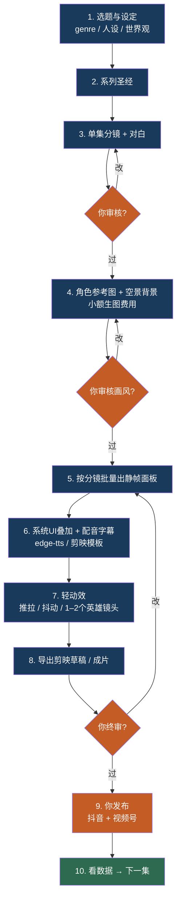

# AI漫剧制作工作流 · 谁做什么

> 你 = Horizon（决策 / 账号 / 最终发布）  
> 我 = Horizon-comic（写稿、分镜、工具、生成、导出）

## 你的位置（橙色节点）

| 节点 | 你做什么 | 我做什么 |
|---|---|---|
| **审核分镜** | 改剧情、对白、节奏、人设意见 | 按你的意见重写 |
| **审核画风** | 看角色/背景图，说像不像、要不要换 | 重生图、锁连续性 |
| **终审成片** | 看完整集，决定发不发 | 按反馈改面板/音轨 |
| **发布** | 用你的抖音/视频号账号发 | 只给成片+标题+话题建议 |
| **看数据** | 告诉我播放/完播/评论 | 据此改下一集钩子 |

## 现在卡在哪

**已完成：** 1 选题 → 2 系列圣经 → 3 Ep1 分镜（待你审核）  
**你当前动作：** 读 `ep01-storyboard.md`，说改哪里  
**通过后下一步：** 4 角色参考图（第一次产生图片费用，会先报价）

## 钱与电脑

- 生图 API：我跑在我的电脑上，你只确认预算
- 剪映终修 / 发抖音·视频号：只在你手机或电脑上
- 故事技能 / 分镜：我这边，零图片费用
